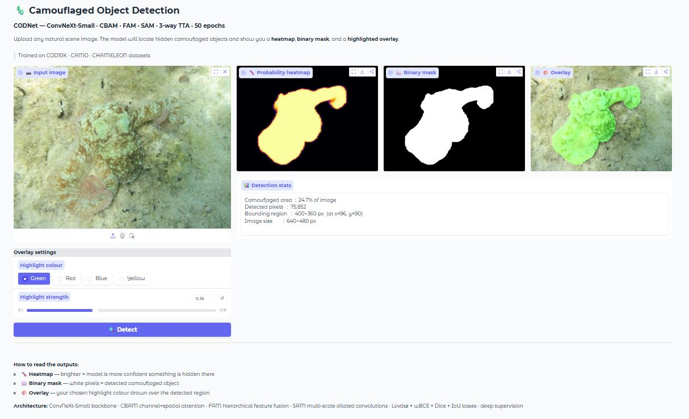
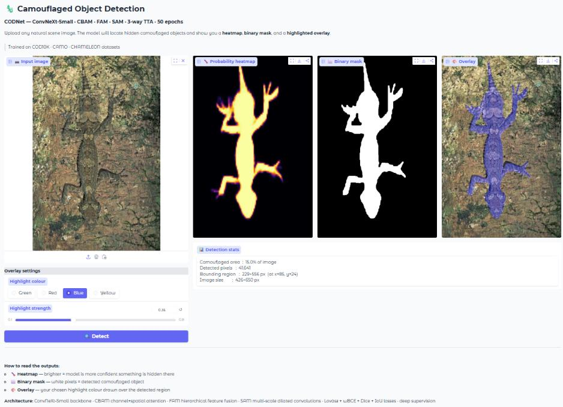
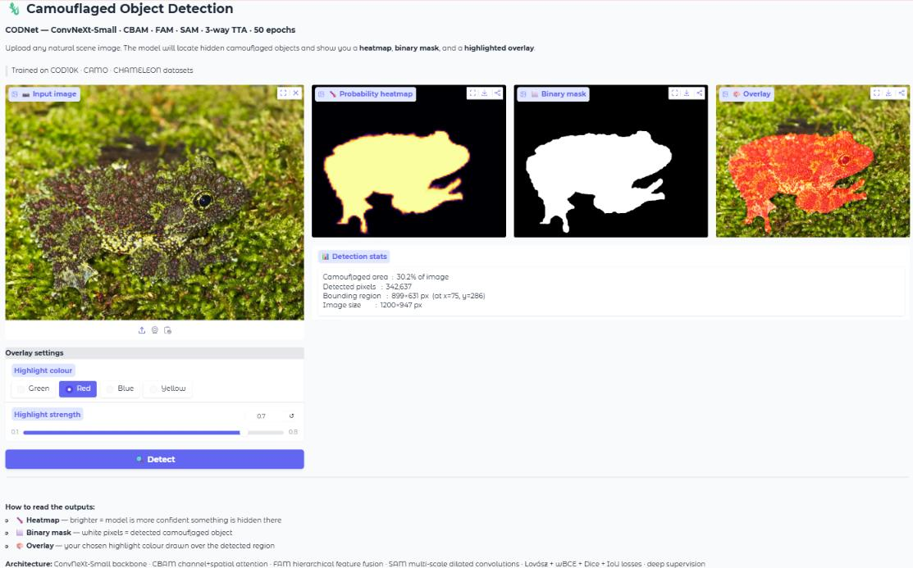
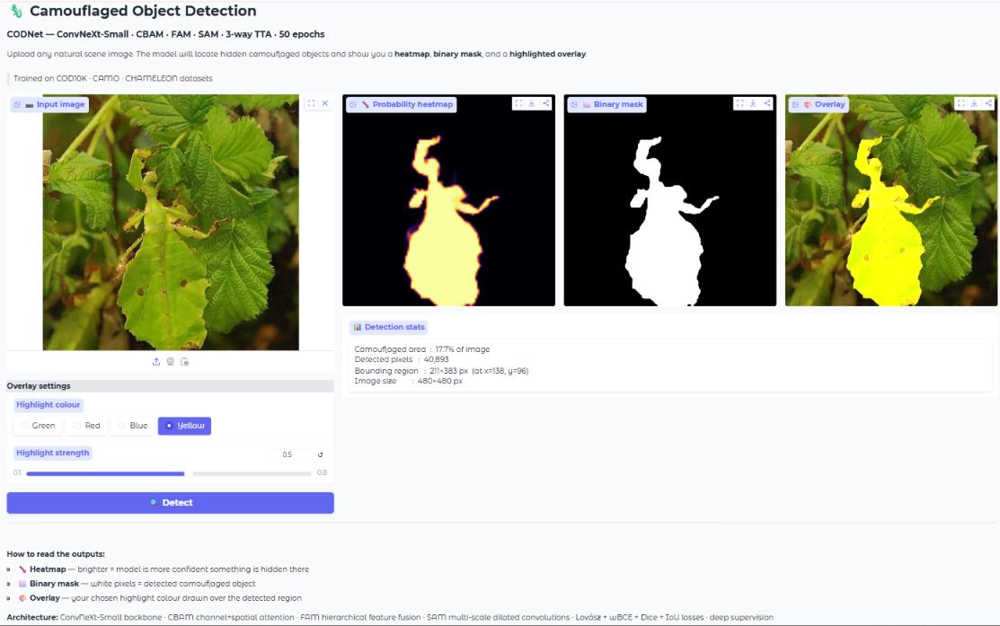
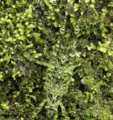
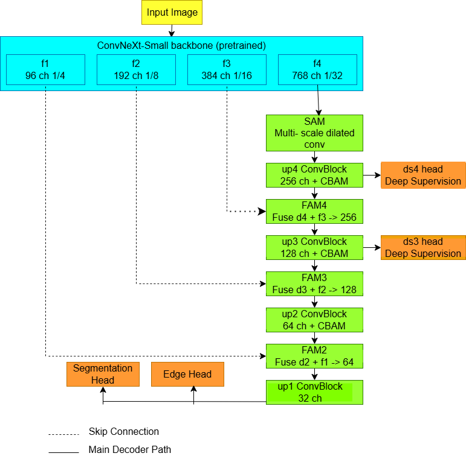

# Camouflaged Object Detection Using Deep Learning

A deep learning project for detecting and segmenting objects that blend into their surroundings. The model uses a **ConvNeXt-Small encoder–decoder**, attention-based feature enhancement, multi-scale feature aggregation, and edge-aware learning to produce segmentation masks for camouflaged objects.

  <a href="https://huggingface.co/spaces/penguin18/camouflage-object-detection"><strong>🚀 Try the Live Demo on Hugging Face Spaces</strong></a>

## Demo

Upload a camouflaged image to the live app to view the input image, probability heatmap, binary segmentation mask, and highlighted overlay.

  

More examples from the deployed application:

| Example 1 | Example 2 |
|:---:|:---:|
|  |  |
|  |  |

## Model Architecture

The network follows an encoder–decoder design. A pretrained ConvNeXt-Small backbone extracts hierarchical features. The decoder combines features at multiple scales using Feature Aggregation Modules (FAM), with attention blocks to refine channel and spatial information. An auxiliary edge-prediction branch supports boundary refinement, and deep supervision guides intermediate predictions.

  

### Key components

- **ConvNeXt-Small encoder:** extracts multi-level visual features.
- **Spatial/scale-aware module (SAM):** processes high-level features with multi-scale dilated convolutions.
- **CBAM attention:** refines channel and spatial feature responses.
- **Feature Aggregation Modules (FAM):** fuse high-level semantic information with lower-level spatial details.
- **Edge-aware learning:** adds an auxiliary edge prediction branch to help preserve object boundaries.
- **Hybrid loss:** combines segmentation objectives including BCE, Dice, IoU and Lovász loss, as documented in the project report.
- **Test-time augmentation:** combines predictions from transformed inputs during inference.

## Dataset

The project uses camouflaged images paired with ground-truth segmentation masks.

| Split / Dataset | Images |
|:---|---:|
| Training data from COD10K | 4,040 |
| Training subset (85%) | 3,434 |
| Validation subset (15%) | 606 |
| CAMO test set | 250 |
| CHAMELEON test set | 76 |
| COD10K test set | 2,026 |
| **Total images reported** | **6,392** |

Images and masks are resized to 448 × 448 pixels and normalized. Random horizontal flipping is used for training augmentation.

## Results

The report gives the following overall evaluation results for the proposed model:

| Metric | Result | Interpretation |
|:---|---:|:---|
| MAE | **0.0300** | Lower is better |
| F-measure (F-β) | **0.8040** | Higher is better |
| E-measure | **0.9147** | Higher is better |
| S-measure | **0.9552** | Higher is better |

### Comparison with reported baselines

| Model | MAE ↓ | F-measure ↑ | E-measure ↑ | S-measure ↑ |
|:---|---:|---:|---:|---:|
| OSFormer | 0.034 | 0.701 | 0.881 | 0.811 |
| SegMar | 0.035 | 0.699 | 0.890 | 0.813 |
| SLT-Net | 0.036 | 0.681 | 0.875 | 0.804 |
| FEDER | 0.032 | 0.740 | 0.900 | 0.823 |
| **Proposed model** | **0.030** | **0.804** | **0.915** | **0.955** |

*Baseline values are reproduced from the project report; comparisons can depend on evaluation protocol and dataset setup.*

## Technology Stack

- **Language:** Python
- **Deep learning:** PyTorch, timm, ConvNeXt-Small
- **Image processing:** OpenCV, Pillow, NumPy
- **Visualization:** Matplotlib
- **Deployment:** Hugging Face Spaces

## How to Use the Demo

1. Open the [live Hugging Face Space](https://huggingface.co/spaces/penguin18/camouflage-object-detection).
2. Upload a camouflaged image.
3. Run detection.
4. Inspect the probability heatmap, binary mask, and overlay to understand the predicted object region.

## Limitations and Future Work

The current project focuses on still images rather than video or real-time streams. Performance may vary with dataset diversity and especially difficult camouflage, and the model may require optimization for resource-constrained deployment. Future directions include video-based detection, lightweight architectures, and further boundary refinement.

## Acknowledgements

Project completed as part of the M.Sc. Computer Science programme at the National Institute of Technology, Tiruchirappalli, under the guidance of Dr. Balaji Banothu.

---

**Note:** The screenshots and architecture image in this repository are stored in the `images/` folder. Keep that folder at the same level as this `README.md` so GitHub can render the images.
